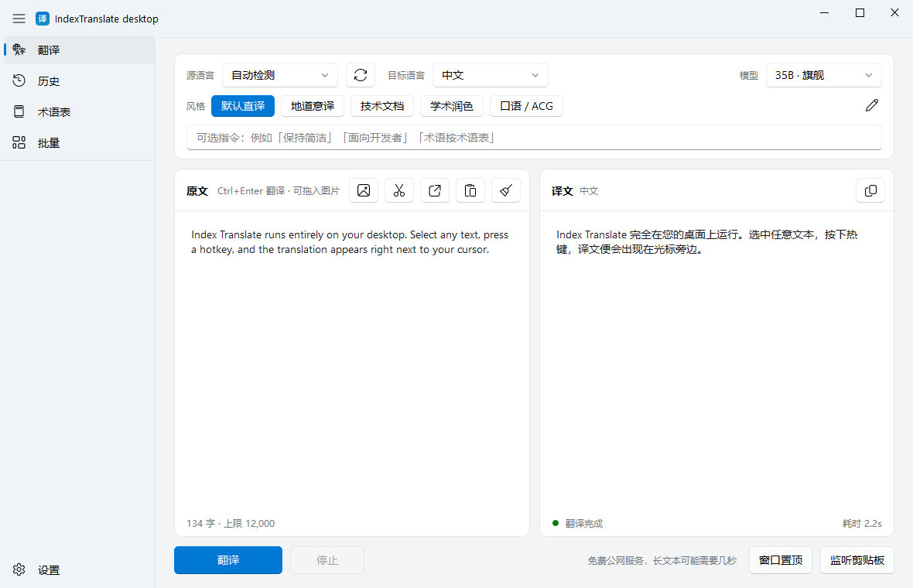

# IndexTranslate desktop

一款 Windows 桌面翻译客户端，调用 **B 站 Index-Translate** 公网翻译服务（`https://index-translate.bilibili.com/v1`），**无需 API Key、无需登录**。

支持**文本翻译**与**图片翻译**，流式输出、术语表、指令约束、历史记录、本地代理（可接入沉浸式翻译）、深浅色主题。

还提供一整套**系统级集成**：托盘常驻、全局热键划词浮窗、框选截屏翻译、剪贴板自动监听、窗口置顶、开机静默自启——不切窗口也能随手翻译。

也能按需切换**风格预设**（直译 / 意译 / 技术文档 / 学术 / 口语），把**术语表按分组**隔开各自的领域，用**批量队列**一次翻完一叠截图或整份字幕，并且**自动记住输入草稿**。



<p align="center">
  
</p>

---

## 目录

- [核心功能](#核心功能)
- [快速开始](#快速开始)
- [下载与安装](#下载与安装)
- [关于"Could not create temporary directory!"](#关于could-not-create-temporary-directory)
- [系统级功能](#系统级功能)
- [使用说明](#使用说明)
- [本地代理：接入沉浸式翻译](#本地代理接入沉浸式翻译)
- [从源码运行](#从源码运行)
- [自行打包](#自行打包)
- [项目结构](#项目结构)
- [数据存放位置](#数据存放位置)
- [自检与测试](#自检与测试)
- [已知限制](#已知限制)
- [致谢与许可](#致谢与许可)

---

## 核心功能

| 功能 | 说明 |
| --- | --- |
| 文本翻译 | 32 种语言，源语言可自动检测；SSE 流式输出，边翻边出 |
| 图片翻译 | 拖入 / `Ctrl+V` 粘贴截图 / 选择文件 / **http(s) 图片链接**，自动压缩超大图 |
| 风格预设 | 「默认直译 / 地道意译 / 技术文档 / 学术润色 / 口语 · ACG」一键切换，可自行增删改 |
| 术语表 | 自定义 `原词 → 译法` 对照；**支持分组**（游戏 / 开发 / 业务各一套），只把原文里真出现的词注入提示词 |
| 指令约束 | 顶部「可选指令」输入框可临时追加要求（如"只输出三个词以内"），也可在设置里配默认值 |
| 批量队列 | 多张截图 + `.srt` / `.md` / `.txt` 一次拖入，按顺序排队翻译，单条重试，合并导出双语 Markdown |
| 草稿保存 | 输入一段就自动存一次（防抖 500 ms），关掉程序再打开，原文、语种、模型都还在 |
| 翻译历史 | SQLite 本地存储，缩略图 + 原文 + 译文 + 耗时，支持搜索、一键回填、再次翻译 |
| 模型切换 | 35B（旗舰）/ 9B（均衡）/ 2B（极速）三档 |
| 本地代理 | 内置 OpenAI 兼容代理，可供沉浸式翻译等第三方工具调用 |
| 代理抗限流 | 并发排队 + 令牌桶限流 + 结果缓存 + 术语注入 + 模型自动降级，二次刷新毫秒命中 |
| 全局划词 | 任意程序里选中文字，按 `Ctrl+Alt+T`，鼠标旁弹出浮窗直接出译文 |
| 框选截屏 | 按 `Ctrl+Alt+S` 拖框选区，松手即压缩上传并翻译，省掉"截图 → 回窗口 → 粘贴" |
| 剪贴板监听 | 一键开启后，复制文字自动翻译，适合看 PDF / 查报错 / 玩外文游戏 |
| 系统托盘 | 关闭窗口最小化到托盘，本地代理继续常驻；托盘菜单可快速唤起或退出 |
| 开机自启 | 可静默启动到托盘，并可顺带自动开启本地代理 |
| 窗口置顶 | 一键置顶，对照文档翻译时不会被盖住 |
| 深浅色主题 | 跟随系统或手动指定 |
| 流式中断 | 随时点「停止」保留已生成的部分译文 |

---

## 快速开始

1. 下载 Release 里的压缩包并解压。
2. 双击 `IndexTranslate-desktop.exe`。
3. 在左侧粘贴原文，回车或按 `Ctrl+Enter` 开始翻译。

> 无需安装 Python，无需任何配置，服务端点默认已内置。

---

## 下载与安装

前往 **[发行版](https://github.com/4KAForever11/IndexTranslate-desktop/releases)** 下载：

| 产物 | 适用场景 | 说明 |
| --- | --- | --- |
| `IndexTranslate-desktop-<版本>-win64.zip` | **推荐** | 文件夹版，解压即用，启动最快，不会触碰系统临时目录 |
| `IndexTranslate-desktop-<版本>-win64-onefile.exe` | 单文件 | 只有一个 exe，体积较大，启动时会在自身目录解包 |

解压后目录结构：

```
IndexTranslate-desktop/
└─ IndexTranslate-desktop.exe   ← 双击运行
```

---

## 关于 "Could not create temporary directory!"

这是 PyInstaller **单文件版**的典型问题：单文件 exe 启动时要把自身解包到 `%TEMP%`，而很多国内 Windows 环境的用户目录被安全软件 / 权限策略锁死（`C:\Users\<中文用户名>\AppData\Local\Temp` 常见），于是弹出该报错。

**管理员运行就不报错**，正是这个原因——提权后的令牌有权写那个目录。

本项目做了两手处理：

1. **文件夹版（默认发布产物）根本不解包**，因此完全不受该问题影响；
2. **单文件版**在打包时指定了 `--runtime-tmpdir .IndexTranslateRuntime`，解包目录固定在 exe 所在目录，**完全绕开 `%TEMP%`**。

此外，应用在数据目录不可写时（受限配置 / 只读盘）会自动降级为内存数据库，**保证窗口仍能正常打开**。

---

## 系统级功能


### 全局快捷键

| 快捷键 | 功能 |
| --- | --- |
| `Ctrl + Alt + T` | 划词翻译：取当前选中的文字，在鼠标旁弹出浮窗 |
| `Ctrl + Alt + S` | 框选截屏翻译：拖动框选屏幕区域，松手即翻译 |

两个快捷键都可以在「设置 → 系统集成」里改成别的组合。

**划词浮窗**会先备份剪贴板再模拟 `Ctrl+C` 取词，取完立刻还原原来的剪贴板内容，不会打乱你正在复制的东西。浮窗里可以直接「复制」译文，或点「转到主窗口」把原文带到主界面继续编辑。

**框选截屏**是全屏半透明遮罩：按住鼠标拖出一个矩形，松手后自动裁切、压缩并开始翻译；`Esc` 或右键取消。

### 托盘与开机自启

- 默认「关闭窗口时最小化到托盘」，本地代理不会随窗口关闭而中断。
- 托盘菜单：打开主窗口 / 划词翻译 / 截屏翻译 / 本地代理开关 / 最小化到托盘 / 开机静默自启 / 退出。
- 「开机静默自启」把启动项写入 `HKCU\Software\Microsoft\Windows\CurrentVersion\Run`（值名 `IndexTranslateDesktop`），启动时带 `--silent` 只进托盘不弹窗。
- 勾上「启动时自动开启本地代理」后，开机即接管沉浸式翻译的请求。

### 剪贴板监听与窗口置顶

翻译页右下角两个开关：

- **监听剪贴板**：开启后每次复制文字都会自动翻译；同一段文字重复复制不会重复请求。窗口最小化时只把文字载入输入框、不偷偷发请求，回到窗口点「翻译」即可。
- **已置顶**：窗口保持最前，适合边看文档边翻译。

---

## 使用说明

### 快捷键

| 快捷键 | 功能 |
| --- | --- |
| `Ctrl + Enter` | 开始翻译 |
| `Ctrl + Shift + C` | 复制译文 |
| `Ctrl + L` | 清空输入与结果 |
| `Ctrl + 1` ~ `Ctrl + 5` | 切换 翻译 / 历史 / 术语表 / 批量 / 设置 |
| `Ctrl + Alt + T` | 全局划词翻译（窗口不在前台也生效） |
| `Ctrl + Alt + S` | 全局框选截屏翻译 |

### 图片翻译

- 把图片**拖进窗口**；
- 截图后 `Ctrl+V` 粘贴；
- 点工具栏的图片按钮选择文件；
- 点链接按钮输入 `http(s)` 图片地址。

图片超过 **2048 px** 或 **4 MB** 会自动等比压缩后上传；服务只接受 Base64，远程链接会先在本地下载再转 Base64。

### 历史记录


- 每次翻译（文本或图片）都会自动入历史，记录原文、译文、语种、模型和用时；图片附带缩略图。
- 搜索框同时匹配**原文与译文**，边打字边筛；结果分页加载（每次 50 条），底部「加载更多」继续往下翻。
- 每行右侧三个按钮：**复制译文**、**载入到翻译页**（把这条原文带回主界面继续改）、**删除这条记录**。
- 保留条数在「设置 → 翻译选项 → 历史保留条数」里设定（默认 500，设 0 表示不自动清理）。

### 风格预设（解决"偏直译"）

默认提示词与 `call_api.py` 严格一致，因此默认输出偏直译。翻译页顶部那排芯片就是为此准备的：


| 预设 | 效果 |
| --- | --- |
| 默认直译 | 不附加任何要求，与内置提示词完全一致 |
| 地道意译 | 符合译入语母语者习惯，可调整语序、合并或拆分句子，但不改原意 |
| 技术文档 | 代码、命令、变量名、API 路径保持原样；保留 Markdown 结构与缩进 |
| 学术润色 | 书面、严谨、术语统一，适合论文与报告 |
| 口语 · ACG | 口语化、贴合语境，适合对话、漫画、游戏文本 |

- 点芯片会把预设文本填进下方「可选指令」框，**还能继续手改**；改过的文本如果和某个预设完全一致，芯片会自动高亮。
- 点右侧铅笔可以增删改预设（最多 24 个，名称 12 字、内容 400 字以内），保存后立刻出现在芯片行。
- 想临时加一句要求，直接改指令框即可，不影响预设本身。

### 术语表与分组

在「术语表」页添加 `原词 → 译法`，翻译时以 `【硬性要求】专名/术语对照: A→B、C→D` 注入提示词。导入支持 `A=>B`、`A→B`、`A->B`、`A=B`、`A: B`、制表符分隔；`#` 开头为注释。


分组解决的是"同一行词在不同领域译法不同"的问题：

- `季卡` 在「游戏」里是 `Season Pass`，在「业务」里可以是 `Quarterly Card`——同一个词在两个分组各存一条，互不覆盖。
- 每个分组可以**单独停用**，停用的分组完全不参与注入。玩游戏时只开「游戏」，写代码时只开「开发」。
- 注入是**按命中做的**：只有原文里真的出现过的术语才会写进提示词，最长匹配优先，单次最多 40 条。这样既避免跨领域串味，也减少提示词体积、压低首字延迟。
- 支持新建 / 重命名 / 删除分组，导入导出都跟随当前分组（导出文件名形如 `术语表-游戏.txt`）。

### 批量图片与文档


- 一次拖入**多张图片**（漫画、PPT 截图、外文资料）或 **`.srt` / `.md` / `.txt`** 文档；拖文件夹也可以（取一层内的受支持文件）。
- 文档会先切段：Markdown / 纯文本按空行分段（过短的段落自动合并，避免碎片请求）；`srt` 按字幕条切，保留时间轴。
- 队列按设定的并发数（1–4，默认 1）依次提交，每行显示状态、`已翻/总数`、用时和摘要；任意一条失败可以单独重试，失败不会拖垮整批。
- 完成后点「导出」，可选**双语对照 / 仅译文 / 原文 + 译文分节**三种格式，合并成一份 Markdown 保存。
- 图片项在导出里以 `（图片：文件名）` 占位——服务只回译文，不回 OCR 原文。

### 草稿自动保存

输入框里每敲一段（防抖 500 ms）就把**原文 + 源语言 + 目标语言 + 当前模型**写进 `settings.json`，正常退出（包括关窗进托盘）时会立刻落盘。下次启动自动恢复，不用重新挑语种、重新粘一遍。

超过 20000 字的草稿只保存前 20000 字，避免配置文件被撑大。

---

## 本地代理：接入沉浸式翻译

「设置 → 本地代理」可启动一个 OpenAI 兼容的本地服务（默认 `127.0.0.1:8080`）：

```
http://127.0.0.1:8080/v1
```

在沉浸式翻译的「自定义 API」里填入该地址，模型名填 `Index-Translate-35B-A3B` 即可。代理会转发请求并自动关闭模型的思维链输出。

代理默认随应用启动，关窗最小化到托盘后依然在线；接口还支持 `/v1/models`、`/v1/health`、`/v1/stats`。

### 代理优化：并发排队 / 限流 / 缓存 / 术语 / 降级

公网免费接口最怕的就是「一个长网页瞬间几十个并发」。代理层为此做了四件事，都在「设置 → 代理优化」里可调：


| 能力 | 默认 | 说明 |
| --- | --- | --- |
| 最大并发 | 4 | 同时在途的上游请求数，超出的请求排队而不是直接打上游 |
| 每秒请求 | 3.0 | 令牌桶速率，`0` 表示不限速；突发上限为 2×速率（至少 6） |
| 结果缓存 | 开，2000 条 / 7 天 | 按「原文 + 参数」做 sha256 键存进 SQLite，网页刷新直接毫秒命中 |
| 注入术语表 | 开 | 原文命中术语表词条时，自动把 `【硬性要求】专名/术语对照` 追加到提示词 |
| 模型自动降级 | 开 | 35B 遇到 429 / 5xx / 超时，自动依次退到 9B、2B |
| 备用端点 | 空 | 内置降级都失败时，转发到你填的 OpenAI 兼容地址（Ollama / 硅基流动 / DeepSeek） |

实测（同一句中文、`stream=true`）：首次 1500 ms 左右，命中缓存后 <1 ms 返回，并带上 `X-Proxy-Cache: HIT` 响应头。

几点实现细节：

- **缓存键**只取影响译文的字段（`model`、`messages`、`temperature`、`max_tokens` 等），`stream` 不影响，所以流式与非流式请求共享同一份缓存。
- **命中缓存时仍然原样返回流式响应**：代理自己把整段译文切成 SSE chunk 发回去，因此沉浸式翻译拿到的格式和上游一致。
- **排队超时**返回 HTTP 503，正文给出中文提示（调低并发或稍后再试），不会静默失败。
- **术语注入**只认术语表里真实出现的词，最长匹配优先，单次最多 40 条，避免把提示词撑爆。
- **备用端点**会被剥掉 B 站专用的 `chat_template_kwargs`，避免本地 Ollama 之类不认识该字段。
- 缓存库是 `proxy_cache.db`，随「清空缓存」按钮清空，随数据目录一起删除。

---

## 从源码运行

需要 Python 3.10+。

```bash
git clone https://github.com/4KAForever11/IndexTranslate-desktop.git
cd IndexTranslate-desktop

pip install -r requirements.txt
python run.py
```

依赖：`PyQt6`、`PyQt6-Fluent-Widgets`、`httpx`、`Pillow`（Windows 另需 `pywin32`）。

---

## 自行打包

```powershell
# 文件夹版（默认，推荐）
powershell -ExecutionPolicy Bypass -File build.ps1

# 单文件版
powershell -ExecutionPolicy Bypass -File build.ps1 -OneFile

# 两者都出
powershell -ExecutionPolicy Bypass -File build.ps1 -Both
```

或双击 `build.cmd`。产物在 `dist/`。

---

## 项目结构

```
IndexTranslate-desktop/
├─ app/
│  ├─ core/           # 与界面无关的逻辑
│  │  ├─ api_client.py     # OpenAI 兼容客户端 + SSE 解析 + 重试
│  │  ├─ prompt_builder.py # 提示词构造（与 call_api.py 保持一致）
│  │  ├─ image_utils.py    # 图片压缩 / Base64 / 缩略图 / 远程下载
│  │  ├─ history_db.py     # SQLite 翻译历史
│  │  ├─ glossary_db.py    # SQLite 术语表（分组 + 按命中注入）
│  │  ├─ styles.py         # 风格预设（默认 / 意译 / 技术 / 学术 / 口语）
│  │  ├─ batch.py          # 批量队列：切段、排队、合并导出
│  │  ├─ proxy_server.py   # 本地 OpenAI 兼容代理（限流/缓存/术语/降级）
│  │  ├─ proxy_manager.py  # 代理生命周期（脱离窗口常驻）
│  │  ├─ proxy_throttle.py # 并发闸门 + 令牌桶
│  │  ├─ proxy_cache.py    # SQLite 译文缓存（LRU + TTL）
│  │  ├─ proxy_utils.py    # 缓存键、术语注入、模型链、SSE 合成
│  │  ├─ global_hotkey.py  # 全局热键（Win32 RegisterHotKey）
│  │  ├─ selection.py      # 取词：备份剪贴板 + 模拟 Ctrl+C
│  │  ├─ autostart.py      # 开机自启（注册表 Run 项）
│  │  ├─ languages.py      # 32 种语言定义
│  │  └─ config.py         # 配置与设置持久化
│  ├─ workers/        # 后台翻译线程
│  ├─ ui/             # 五个页面 + 主题 + 自定义控件
│  │  ├─ batch_page.py     # 批量队列页
│  │  ├─ tray.py           # 系统托盘与菜单
│  │  ├─ popup.py          # 划词翻译浮窗
│  │  ├─ screenshot.py     # 全屏框选遮罩
│  │  └─ ...
│  └─ main.py         # 程序入口
├─ assets/            # 图标
├─ doc/               # 设计文档与截图
├─ tests/             # 单元测试
├─ tools/make_icon.py # 图标生成
├─ build.ps1 / build.cmd
└─ run.py
```

---

## 数据存放位置

默认 `%LOCALAPPDATA%\IndexTranslate`：

| 文件 | 内容 |
| --- | --- |
| `settings.json` | 设置（主题、模型、接口地址、指令、风格预设、草稿…） |
| `history.db` | 翻译历史 |
| `glossary.db` | 术语表与分组 |
| `proxy_cache.db` | 本地代理的译文缓存（可随时清空） |

设置环境变量 `INDEX_TRANSLATE_HOME` 可改为自定义目录（便携使用、U 盘携带都适用）：

```powershell
$env:INDEX_TRANSLATE_HOME = "D:\Tools\IndexTranslate"
```

---

## 自检与测试

```powershell
# 程序自检：真实跑一遍文本 + 图片翻译，结果写入数据目录 selftest.json
.\dist\IndexTranslate-desktop\IndexTranslate-desktop.exe --selftest

# 单元测试
python -m unittest discover -s tests
```

测试覆盖（64 个用例）：提示词与 `call_api.py` 逐字节对齐、术语表解析、图片压缩、远程图片下载、SQLite 读写、SSE 解析、代理转发，代理的抗限流四件套（缓存键稳定性、术语注入、模型降级链、令牌桶与并发闸门、缓存 LRU/TTL），以及风格预设归一化、术语表分组与命中注入、批量切段（Markdown / SRT）与三种导出格式。

---

## 已知限制

- 依赖公网免费服务，可能限流或临时不可用；长文本需要多等几秒。代理层的排队、限流与缓存就是为了压低这个概率，但无法完全消除。
- 默认提示词与 `call_api.py` 严格对齐，因此默认输出偏"直译"；需要自然些可以切「地道意译」等风格预设，但效果取决于模型本身。
- 服务端只接受 Base64 图片，不接受远程地址（客户端会先下载再转换）。
- 全局热键走 Win32 `RegisterHotKey`，同一组合被其他程序占用时会提示换一个。
- 取词依赖模拟 `Ctrl+C`，对少数不响应复制的自绘界面（部分游戏、远程桌面）拿不到文字。
- 批量队列里的图片只能拿到译文，拿不到原文字幕式的逐行对照；文档切段按空行/字幕条进行，排版过于复杂的 Markdown（嵌套表格等）可能会被拆散。
- 术语表按子串匹配注入，不做词形还原，因此英文复数、时态变体需要自己多补一条。

---

## 致谢与许可

- 翻译服务由[B 站 Index-Translate](https://github.com/bilibili/Index-Translate)提供，遵循其公开使用条款。
- 提示词与调用方式参考仓库内的 [`call_api.py`](call_api.py)。
- 界面基于 [PyQt6-Fluent-Widgets](https://github.com/QtExcel/PyQt-Fluent-Widgets)。
- 本项目以 MIT 许可证发布。
