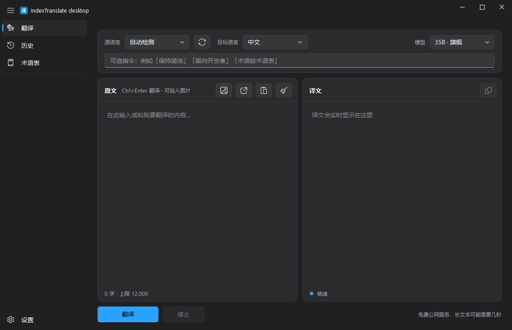
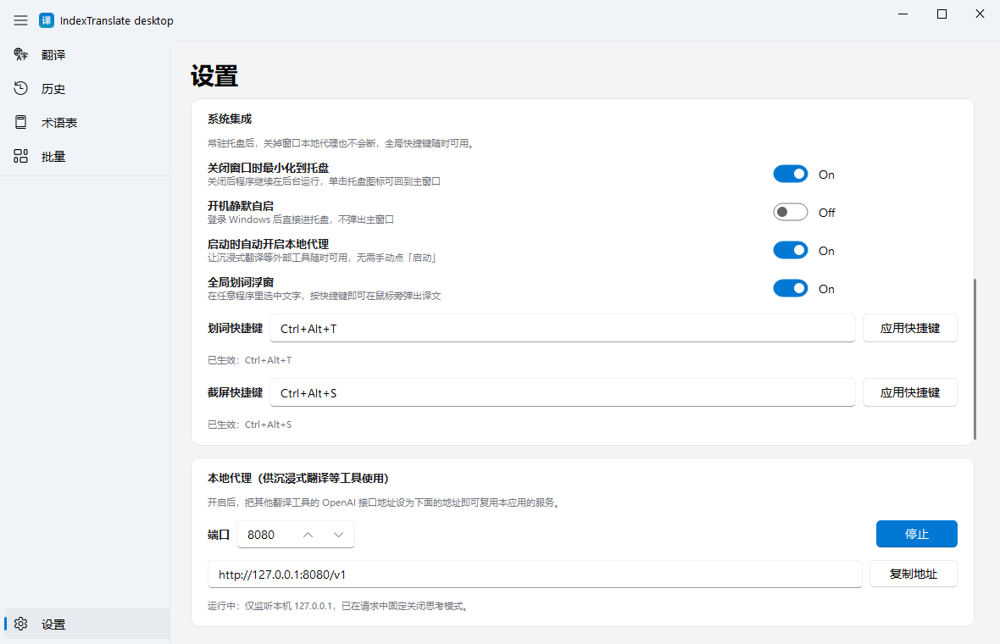
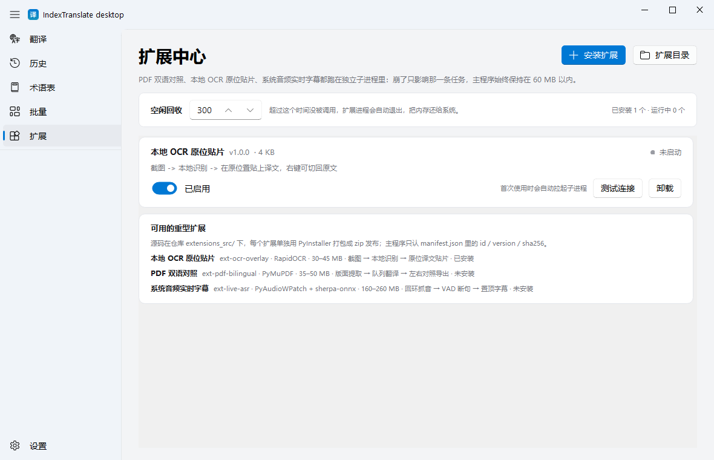
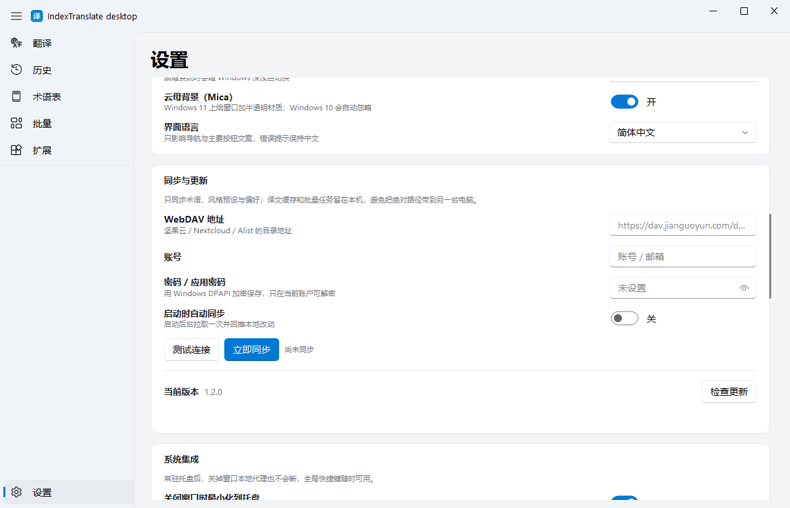
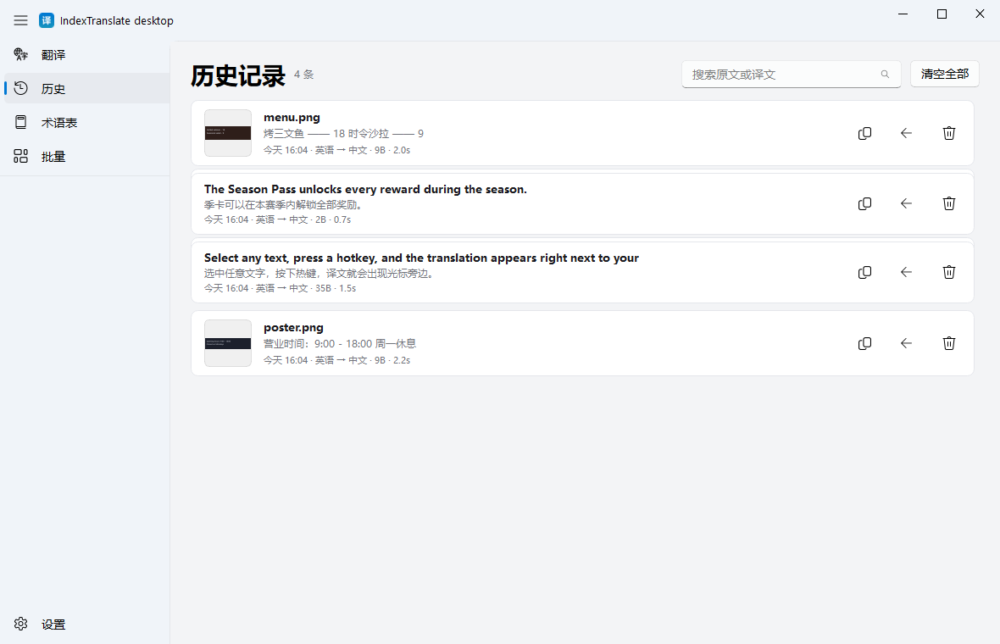
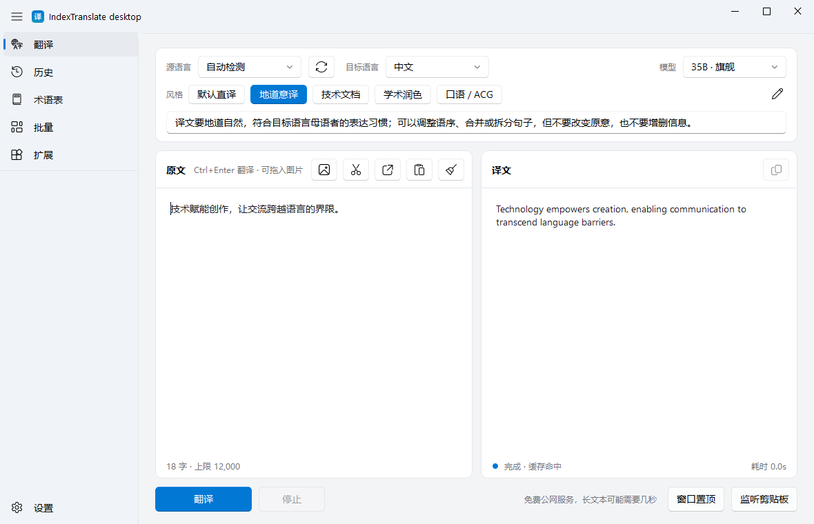
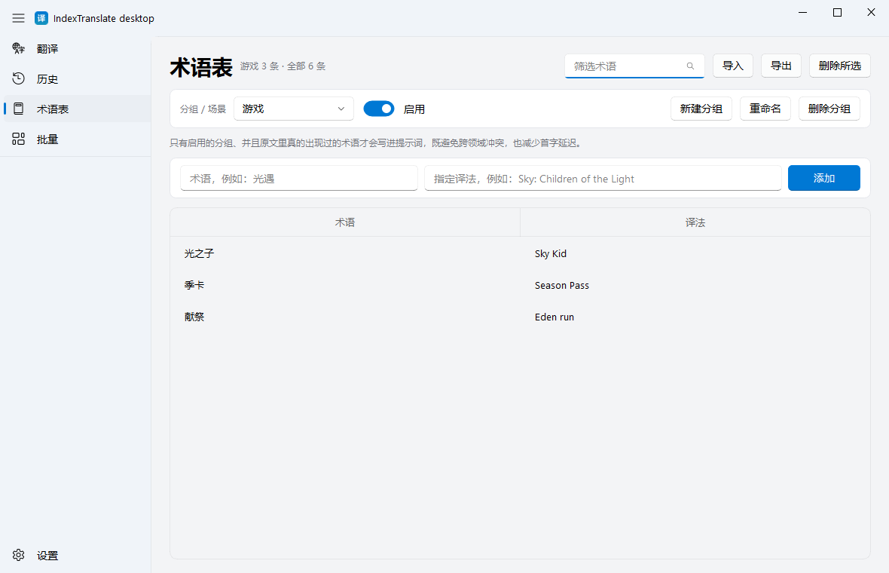
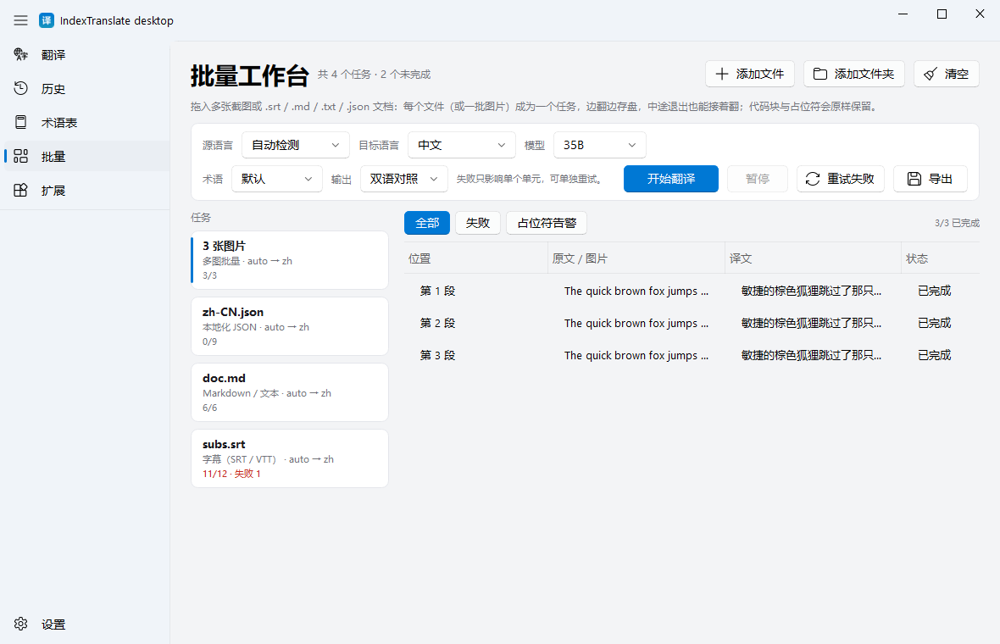
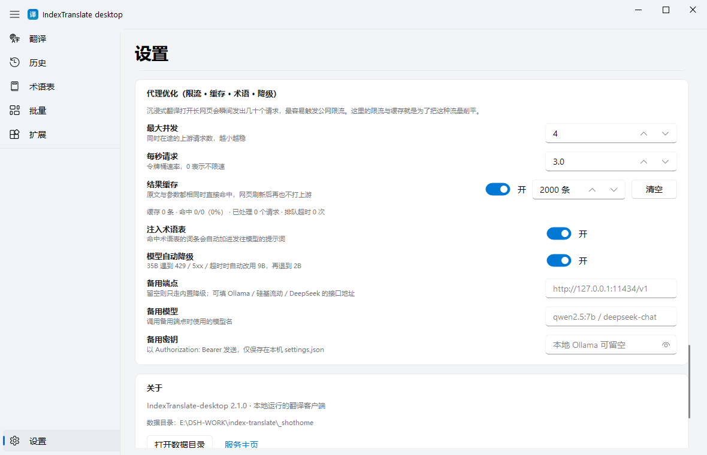
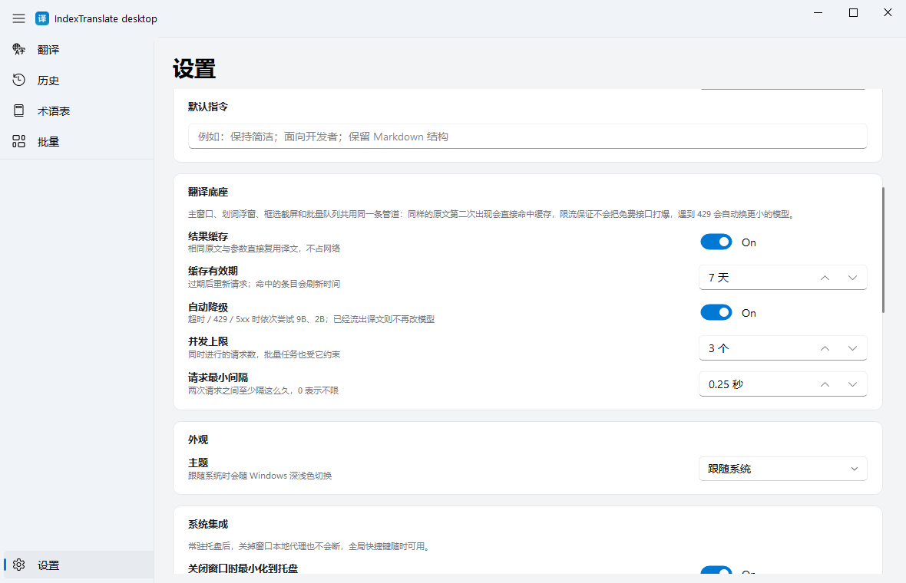

# IndexTranslate desktop

一款 Windows 桌面翻译客户端，调用 **B 站 Index-Translate** 公网翻译服务（`https://index-translate.bilibili.com/v1`），**无需 API Key、无需登录**。

支持**文本翻译**与**图片翻译**，流式输出、术语表、指令约束、历史记录、本地代理（可接入沉浸式翻译）、深浅色主题。

还提供一整套**系统级集成**：托盘常驻、全局热键划词浮窗、框选截屏翻译、剪贴板自动监听、窗口置顶、开机静默自启——不切窗口也能随手翻译。

也能按需切换**风格预设**（直译 / 意译 / 技术文档 / 学术 / 口语），把**术语表按分组**隔开各自的领域，用**批量队列**一次翻完一叠截图或整份字幕，并且**自动记住输入草稿**。


<p align="center">
  
</p>

---

## 目录

- [核心功能](#核心功能)
- [快速开始](#快速开始)
- [下载与安装](#下载与安装)
- [关于"Could not create temporary directory!"](#关于could-not-create-temporary-directory)
- [系统级功能](#系统级功能)
- [扩展、同步与更新](#扩展同步与更新)
- [使用说明](#使用说明)
- [本地代理：接入沉浸式翻译](#本地代理接入沉浸式翻译)
- [从源码运行](#从源码运行)
- [自行打包](#自行打包)
- [项目结构](#项目结构)
- [翻译底座（V2）](#翻译底座v2)
- [数据存放位置](#数据存放位置)
- [自检与测试](#自检与测试)
- [已知限制](#已知限制)
- [致谢与许可](#致谢与许可)

---

## 核心功能

| 功能 | 说明 |
| --- | --- |
| 文本翻译 | 32 种语言，源语言可自动检测；SSE 流式输出，边翻边出 |
| 图片翻译 | 拖入 / `Ctrl+V` 粘贴截图 / 选择文件 / **http(s) 图片链接**，自动压缩超大图 |
| 风格预设 | 「默认直译 / 地道意译 / 技术文档 / 学术润色 / 口语 · ACG」一键切换，可自行增删改 |
| 术语表 | 自定义 `原词 → 译法` 对照；**支持分组**（游戏 / 开发 / 业务各一套），只把原文里真出现的词注入提示词 |
| 指令约束 | 顶部「可选指令」输入框可临时追加要求（如"只输出三个词以内"），也可在设置里配默认值 |
| 批量队列 | **批量工作台**：多图 + `.srt` / `.vtt` / `.md` / `.txt` / `.json` 统一排队，断点续翻、占位符保护、单条重试、结构性导出 |
| 草稿保存 | 输入一段就自动存一次（防抖 500 ms），关掉程序再打开，原文、语种、模型都还在 |
| 翻译历史 | SQLite 本地存储，缩略图 + 原文 + 译文 + 耗时，支持搜索、一键回填、再次翻译 |
| 模型切换 | 35B（旗舰）/ 9B（均衡）/ 2B（极速）三档 |
| 翻译底座 | 所有入口共用一条管道：术语命中 → 缓存 → 限流 → 引擎 → 自动降级，二次相同原文 0ms 命中 |
| 本地代理 | 内置 OpenAI 兼容代理，可供沉浸式翻译等第三方工具调用 |
| 代理抗限流 | 并发排队 + 令牌桶限流 + 结果缓存 + 术语注入 + 模型自动降级，二次刷新毫秒命中 |
| 全局划词 | 任意程序里选中文字，按 `Ctrl+Alt+T`，鼠标旁弹出浮窗直接出译文 |
| 框选截屏 | 按 `Ctrl+Alt+S` 拖框选区，松手即压缩上传并翻译，省掉"截图 → 回窗口 → 粘贴" |
| 输入框替换 | 按 `Ctrl+Alt+R` 把当前输入框里的内容（或选中的一段）翻译后原地粘回去，剪贴板不受影响 |
| 剪贴板监听 | 一键开启后，复制文字自动翻译，适合看 PDF / 查报错 / 玩外文游戏 |
| 系统托盘 | 关闭窗口最小化到托盘，本地代理继续常驻；托盘菜单可快速唤起或退出 |
| 开机自启 | 可静默启动到托盘，并可顺带自动开启本地代理；二次启动只唤醒已有窗口（单实例） |
| 窗口置顶 | 一键置顶，对照文档翻译时不会被盖住 |
| 扩展中心 | PDF 双语对照 / 本地 OCR 原位贴片 / 系统音频实时字幕，按需下载安装，跑在独立子进程里 |
| 在线目录 | 扩展中心内置清单，一键安装/更新，下载后校验 SHA-256；默认读本仓库，可换镜像地址 |
| 官方渠道 | 「关于」与托盘菜单内置官方 GitHub 按钮，便于核对来源、识别改包 |
| 跨设备同步 | 术语表、风格预设与偏好打包成 JSON 快照走 WebDAV，按 `uuid` 合并、软删除，密码用 DPAPI 加密 |
| 检查更新 | 直接读 GitHub Releases，比较语义版本，可下载并校验 SHA-256 后由临时脚本替换 |
| 界面语言 | 简体中文 / 繁體中文 / English 词表切换（导航与主要按钮） |
| 深浅色主题 | 跟随系统或手动指定；Windows 11 上可开 Mica 云母材质 |
| 流式中断 | 随时点「停止」保留已生成的部分译文 |

---

## 快速开始

1. 下载 Release 里的压缩包并解压。
2. 双击 `IndexTranslate-desktop.exe`。
3. 在左侧粘贴原文，回车或按 `Ctrl+Enter` 开始翻译。

> 无需安装 Python，无需任何配置，服务端点默认已内置。

---

## 下载与安装

前往 **[发行版](https://github.com/4KAForever11/IndexTranslate-desktop/releases)** 下载：

| 产物 | 适用场景 | 说明 |
| --- | --- | --- |
| `IndexTranslate-desktop-<版本>-win64.zip` | **推荐** | 文件夹版，解压即用，启动最快，不会触碰系统临时目录 |
| `IndexTranslate-desktop-<版本>-win64-onefile.exe` | 单文件 | 只有一个 exe，体积较大，启动时会在自身目录解包 |

解压后目录结构：

```
IndexTranslate-desktop/
└─ IndexTranslate-desktop.exe   ← 双击运行
```

> **防伪提示**：本软件只有两个官方渠道——本 README 所在的
> [GitHub 仓库](https://github.com/4KAForever11/IndexTranslate-desktop) 和它的
> [发行版页面](https://github.com/4KAForever11/IndexTranslate-desktop/releases)。
> 没有任何「高速下载站」「网盘分流」「绿色版」。
> 程序内「设置 → 关于」和托盘菜单里都有 **官方 GitHub 仓库** 按钮，点开对照一下地址即可；
> 遇到同名软件请核对地址与版本号——被改包的程序常伴随广告注入或后门。

---

## 关于 "Could not create temporary directory!"

这是 PyInstaller **单文件版**的典型问题：单文件 exe 启动时要把自身解包到 `%TEMP%`，而很多国内 Windows 环境的用户目录被安全软件 / 权限策略锁死（`C:\Users\<中文用户名>\AppData\Local\Temp` 常见），于是弹出该报错。

**管理员运行就不报错**，正是这个原因——提权后的令牌有权写那个目录。

本项目做了两手处理：

1. **文件夹版（默认发布产物）根本不解包**，因此完全不受该问题影响；
2. **单文件版**在打包时指定了 `--runtime-tmpdir .IndexTranslateRuntime`，解包目录固定在 exe 所在目录，**完全绕开 `%TEMP%`**。

此外，应用在数据目录不可写时（受限配置 / 只读盘）会自动降级为内存数据库，**保证窗口仍能正常打开**。

---

## 系统级功能



### 全局快捷键

| 快捷键 | 功能 |
| --- | --- |
| `Ctrl + Alt + T` | 划词翻译：取当前选中的文字，在鼠标旁弹出浮窗 |
| `Ctrl + Alt + S` | 框选截屏翻译：拖动框选屏幕区域，松手即翻译 |
| `Ctrl + Alt + R` | 输入框替换：翻译当前选区（没有选区就全选），并把译文粘回原位置 |

三个快捷键都能在「设置 → 系统集成」里改成别的组合；被别的软件占用时会明确提示「已被其他程序占用」而不是静默失效。

热键用 Win32 `RegisterHotKey` + Qt 原生事件过滤器实现：不起消息线程、不装全局键盘钩子（国产杀软对 `SetWindowsHookEx` 很敏感），窗口收进托盘、主界面不在前台时同样有效。

**划词浮窗**取词前先备份剪贴板，取完立刻还原，不会打乱你正在复制的东西。浮窗右上角的图钉可以锁定「点外部不关闭」；未锁定时鼠标点到别处会自动消失并取消进行中的请求（不会把上一次的译文串到下一次）。

**框选截屏**是全屏半透明遮罩：按住鼠标拖出一个矩形，松手后按 `devicePixelRatio` 裁切（高分屏裁出来的是物理原生像素，不糊），自动压缩并开始翻译；`Esc` 或右键取消。结果默认回主窗口，也可以改成「浮窗（不切窗口）」，框完就在鼠标旁出译文。

**输入框替换**是「顺手白捡」的那一步：在任意输入框里按 `Ctrl+Alt+R`，它取走选区（没有选区就先 `Ctrl+A`）→ 用极速模型 2B 翻译 → 把译文粘回去。全程不切窗口，剪贴板在用完后还原。

### 托盘与开机自启

- 默认「关闭窗口时最小化到托盘」，本地代理不会随窗口关闭而中断。
- 托盘菜单：打开主窗口 / 划词翻译 / 截屏翻译 / 输入框替换 / 本地代理开关 / 最小化到托盘 / 开机静默自启 / 退出。
- 「开机静默自启」把启动项写入 `HKCU\Software\Microsoft\Windows\CurrentVersion\Run`（值名 `IndexTranslateDesktop`），启动时带 `--silent`（或 `--minimized`）只进托盘不弹窗。
- 勾上「启动时自动开启本地代理」后，开机即接管沉浸式翻译的请求。
- **单实例**：程序已经在跑时再双击 exe，只把已有窗口叫到前面，不会出现两个托盘图标、两套热键互相抢。

### 剪贴板监听与窗口置顶

翻译页右下角两个开关：

- **监听剪贴板**：开启后每次复制文字都会自动翻译；同一段文字重复复制不会重复请求。窗口最小化时只把文字载入输入框、不偷偷发请求，回到窗口点「翻译」即可。
- **已置顶**：窗口保持最前，适合边看文档边翻译。

---

## 扩展、同步与更新

主程序刻意保持「轻核心」：只有 PyQt6、httpx、Pillow 和 sqlite3，打出来的包 60 MB 出头。
PDF 解析、本地 OCR、语音识别这些动辄几百 MB、还带 C++ 推理库的能力，全部做成**扩展包**：



| 扩展 | 依赖 | 体积 | 做什么 |
| --- | --- | --- | --- |
| `ext-ocr-overlay` 本地 OCR 原位贴片 | RapidOCR + ONNX Runtime | **94 MB** | 截屏 → 本地识别文字框 → 在原位置盖上译文贴片，`Tab` 切回原文 |
| `ext-pdf-bilingual` PDF 双语对照 | PyMuPDF | **136 MB** | 提取带坐标的文本块 → 送翻译底座 → 生成左右双页对照或原位重排单语版 |
| `ext-live-asr` 系统音频实时字幕 | PyAudioWPatch + sherpa-onnx | **30 MB** | 回环捕获系统声音 → VAD 断句 → 逐句翻译，顶部置顶字幕条显示（识别模型另下 228 MB） |

> 体积是装好真实依赖后重新打出来的实测值（ONNX Runtime、PyMuPDF 各自就占几十上百 MB），
> 三个包合计约 260 MB。它们**不在主程序里**，只有你点「安装」时才会下载。

**实时字幕第一次用要下模型**：扩展中心里装好 `ext-live-asr` 后，下面会出现「实时字幕设置」卡片，
点「下载模型」从 hf-mirror 拉 SenseVoice 小模型（`model.int8.onnx` + `tokens.txt`，共 228 MB，
断点续传、失败自动换源），下完自动写入配置。卡片里还能：

- **选声音来源**：默认「自动（跟随系统默认输出）」，多显示器/多声卡/远程虚拟声卡时可以指定具体回环设备；
- **测试 3 秒**：直接告诉你这条设备有没有声音（峰值/静音），不用先开字幕再猜。

> 回环捕获有个系统级的坑：设备空闲时 WASAPI 只送数字静音，甚至一帧都不送，
> 而用户通常「先开字幕、后播放视频」。所以扩展检测到 2 秒没有帧或 3.5 秒全零，
> 就会重建 PortAudio 实例重开流（最多 20 次），期间字幕条显示「正在重新连接」，
> 一旦拿到真实声音立刻转入正常识别，不会因为开早了就一直哑着。


**为什么不塞进主程序**：体积会从 60 MB 涨到 1 GB 以上，启动变慢，PyMuPDF 与 ONNX Runtime 的
DLL / OpenMP 还会互相打架；更要命的是，推理库一旦段错误，托盘、本地代理和主窗口会一起消失。
拆成子进程后，扩展崩了只影响那一条任务。

实现要点：

- **协议**：stdin/stdout 上跑 JSON Lines（请求带 `id`，响应是 `ok/result` 或 `event` 流），
  不装 `importlib` 进主进程，也不开本地端口——开端口会触发 Windows Defender 防火墙弹窗。
- **进程收尸**：扩展进程进 Win32 Job Object（`JOB_OBJECT_LIMIT_KILL_ON_JOB_CLOSE`），
  主程序被任务管理器强杀，系统也会把子进程一起收掉，不会留下 `ext-*.exe` 僵尸。
- **空闲回收**：默认 300 秒没有调用就优雅退出，把 300 MB–1 GB 的模型内存还给系统，用时再冷启动。
- **只做识别**：三个扩展都不自己调模型，识别结果交回主程序的翻译底座，
  所以术语、缓存、限流、429 降级对这些入口一样生效。
- **缺依赖不会崩**：`ping` 会把缺失的包报回来，界面显示「缺少依赖：…」而不是一个红叉。

安装方式：**设置 → 扩展中心 → 安装扩展**，选一个 zip 即可（校验 `manifest.json` 里的
`id` / `version` / `sha256`，解压到 `<数据目录>\extensions\`，宿主版本不够会直接拒绝）。
自己打包用 `build.ps1 -Target extensions`，每个扩展单独出 zip 和一份带 SHA-256 的清单。

### 在线目录：一键安装，不用自己找包

扩展中心顶部有一条 **在线目录**，从仓库里的 `extensions/catalog.json` 拉取当前可用的扩展：

- 每行显示名称、版本、体积和简介，右侧按钮按状态自动切换 **安装 / 更新到 vX / 已是最新**；
- 下载完先核对目录里给出的 `sha256`，对不上直接删掉并报错，不会把半截包解压进来；
- 目录地址默认指向本仓库的 raw 地址；**raw 拉不动时会自动改用 jsDelivr 镜像**重试一次，
  也可以点 **换地址** 换成自己的镜像（任何托管同格式 JSON 的地址都行，格式见 `extensions/catalog.json`）；
- 目录里的 `host_min` 用来拦住旧版本主程序——新版扩展要求新版宿主，避免装上跑不起来。



- **同步范围**：术语与分组、风格预设、12 项通用偏好。译文缓存和批量任务的绝对路径**不上云**，
  否则换台机器就是一堆失效路径。
- **合并策略**：每条记录带 `uuid` / `updated_at` / `deleted`，按 `updated_at` 后者优先（LWW），
  删除用软删墓碑传播；拉取前自动把本地库备份成 `.bak`。
- **密码**：WebDAV 密码用 Windows DPAPI（`CryptProtectData`）加密后存进 `settings.json`，
  只对当前 Windows 账户可解密，快照里不会出现明文。
- **检查更新**：读 GitHub Releases，比较语义版本，下载后校验 `sha256:` 摘要，
  再生成一个临时 `.bat`（等主进程退出 → 解压覆盖 → 重启 → 自删）。中文路径用 `mbcs` 编码写入，
  `cmd` 不会因为代码页把路径读花。

---

## 使用说明

### 快捷键

| 快捷键 | 功能 |
| --- | --- |
| `Ctrl + Enter` | 开始翻译 |
| `Ctrl + Shift + C` | 复制译文 |
| `Ctrl + L` | 清空输入与结果 |
| `Ctrl + 1` ~ `Ctrl + 5` | 切换 翻译 / 历史 / 术语表 / 批量 / 设置 |
| `Ctrl + Alt + T` | 全局划词翻译（窗口不在前台也生效） |
| `Ctrl + Alt + S` | 全局框选截屏翻译 |
| `Ctrl + Alt + R` | 输入框原地替换（取选区 → 翻译 → 粘回原位置） |

### 图片翻译

- 把图片**拖进窗口**；
- 截图后 `Ctrl+V` 粘贴；
- 点工具栏的图片按钮选择文件；
- 点链接按钮输入 `http(s)` 图片地址。

图片超过 **2048 px** 或 **4 MB** 会自动等比压缩后上传；服务只接受 Base64，远程链接会先在本地下载再转 Base64。

### 历史记录



- 每次翻译（文本或图片）都会自动入历史，记录原文、译文、语种、模型和用时；图片附带缩略图。
- 搜索框同时匹配**原文与译文**，边打字边筛；结果分页加载（每次 50 条），底部「加载更多」继续往下翻。
- 每行右侧三个按钮：**复制译文**、**载入到翻译页**（把这条原文带回主界面继续改）、**删除这条记录**。
- 保留条数在「设置 → 翻译选项 → 历史保留条数」里设定（默认 500，设 0 表示不自动清理）。

### 风格预设（解决"偏直译"）

默认提示词与 `call_api.py` 严格一致，因此默认输出偏直译。翻译页顶部那排芯片就是为此准备的：



| 预设 | 效果 |
| --- | --- |
| 默认直译 | 不附加任何要求，与内置提示词完全一致 |
| 地道意译 | 符合译入语母语者习惯，可调整语序、合并或拆分句子，但不改原意 |
| 技术文档 | 代码、命令、变量名、API 路径保持原样；保留 Markdown 结构与缩进 |
| 学术润色 | 书面、严谨、术语统一，适合论文与报告 |
| 口语 · ACG | 口语化、贴合语境，适合对话、漫画、游戏文本 |

- 点芯片会把预设文本填进下方「可选指令」框，**还能继续手改**；改过的文本如果和某个预设完全一致，芯片会自动高亮。
- 点右侧铅笔可以增删改预设（最多 24 个，名称 12 字、内容 400 字以内），保存后立刻出现在芯片行。
- 想临时加一句要求，直接改指令框即可，不影响预设本身。

### 术语表与分组

在「术语表」页添加 `原词 → 译法`，翻译时以 `【硬性要求】专名/术语对照: A→B、C→D` 注入提示词。导入支持 `A=>B`、`A→B`、`A->B`、`A=B`、`A: B`、制表符分隔；`#` 开头为注释。



分组解决的是"同一行词在不同领域译法不同"的问题：

- `季卡` 在「游戏」里是 `Season Pass`，在「业务」里可以是 `Quarterly Card`——同一个词在两个分组各存一条，互不覆盖。
- 每个分组可以**单独停用**，停用的分组完全不参与注入。玩游戏时只开「游戏」，写代码时只开「开发」。
- 注入是**按命中做的**：只有原文里真的出现过的术语才会写进提示词，最长匹配优先，单次最多 40 条。这样既避免跨领域串味，也减少提示词体积、压低首字延迟。
- 支持新建 / 重命名 / 删除分组，导入导出都跟随当前分组（导出文件名形如 `术语表-游戏.txt`）。

### 批量工作台：多图 + 多格式文档



一次拖入多张图片（漫画、PPT 截图、外文资料），或 `.srt` / `.vtt` / `.md` / `.txt` / `.json` 文档，也可以拖整个文件夹（取一层内的受支持文件）。每个文件（或一批图片）成为一个**任务**：左侧卡片显示进度与成功失败数，右侧表格逐条列出「位置 / 原文或缩略图 / 译文 / 状态」。

- **可插拔解析器**：图片批量、字幕、文档（md/txt）、本地化 JSON 各一个解析器。新增一种格式只要实现 `parse()` 与 `export()`，排队、限流、缓存、重试全部复用。
- **代码块与占位符原样保留**：反引号片段、HTML 标签、`{{var}}`、`{count}`、`%s` 送翻前换成 `⟦P0⟧` 形式的占位符，译文回来后自动还原；还原不上的条目会打上告警，用顶部「占位符告警」筛选器一键列出。
- **断点续翻**：每翻完一条就写进 `jobs.db`。崩溃、断电、直接关程序都不要紧——下次打开任务还在，点「开始翻译」只跑没翻过的条目，已花掉的额度不会重复消耗。
- **结构性导出**：`srt` / `vtt` 的时间轴与序号原样回填；JSON 只改叶子字符串，缩进、键顺序、数字与 URL 都不动，导出的文件仍然 `json.loads` 得通（双语模式会额外生成 `<原名>.对照表.md`）；Markdown 的 frontmatter 与围栏代码块整块跳过、原样保留。
- **节奏可控**：「暂停」在当前条目跑完后停下、不再取新条目；并发与限流走翻译底座，缓存与自动降级同样生效。
- 表格里双击「译文」可以直接改，改完即落库；某一条失败只标红它自己，点「重试失败」只重跑失败项。
- 「导出」可选**双语对照 / 仅译文**；图片任务导出成一份 Markdown 汇总（图片以 `（图片：文件名）` 占位，服务只回译文、不回 OCR 原文）。
- 窗口缩到最小 960×620 也能正常用：工具栏分两行排布，不压字、不出横向滚动条。

### 草稿自动保存

输入框里每敲一段（防抖 500 ms）就把**原文 + 源语言 + 目标语言 + 当前模型**写进 `settings.json`，正常退出（包括关窗进托盘）时会立刻落盘。下次启动自动恢复，不用重新挑语种、重新粘一遍。

超过 20000 字的草稿只保存前 20000 字，避免配置文件被撑大。

---

## 本地代理：接入沉浸式翻译

「设置 → 本地代理」可启动一个 OpenAI 兼容的本地服务（默认 `127.0.0.1:8080`）：

```
http://127.0.0.1:8080/v1
```

在沉浸式翻译的「自定义 API」里填入该地址，模型名填 `Index-Translate-35B-A3B` 即可。代理会转发请求并自动关闭模型的思维链输出。

代理默认随应用启动，关窗最小化到托盘后依然在线；接口还支持 `/v1/models`、`/v1/health`、`/v1/stats`。

### 代理优化：并发排队 / 限流 / 缓存 / 术语 / 降级

公网免费接口最怕的就是「一个长网页瞬间几十个并发」。代理层为此做了四件事，都在「设置 → 代理优化」里可调：



| 能力 | 默认 | 说明 |
| --- | --- | --- |
| 最大并发 | 4 | 同时在途的上游请求数，超出的请求排队而不是直接打上游 |
| 每秒请求 | 3.0 | 令牌桶速率，`0` 表示不限速；突发上限为 2×速率（至少 6） |
| 结果缓存 | 开，2000 条 / 7 天 | 按「原文 + 参数」做 sha256 键存进 SQLite，网页刷新直接毫秒命中 |
| 注入术语表 | 开 | 原文命中术语表词条时，自动把 `【硬性要求】专名/术语对照` 追加到提示词 |
| 模型自动降级 | 开 | 35B 遇到 429 / 5xx / 超时，自动依次退到 9B、2B |
| 备用端点 | 空 | 内置降级都失败时，转发到你填的 OpenAI 兼容地址（Ollama / 硅基流动 / DeepSeek） |

实测（同一句中文、`stream=true`）：首次 1500 ms 左右，命中缓存后 <1 ms 返回，并带上 `X-Proxy-Cache: HIT` 响应头。

几点实现细节：

- **缓存键**只取影响译文的字段（`model`、`messages`、`temperature`、`max_tokens` 等），`stream` 不影响，所以流式与非流式请求共享同一份缓存。
- **命中缓存时仍然原样返回流式响应**：代理自己把整段译文切成 SSE chunk 发回去，因此沉浸式翻译拿到的格式和上游一致。
- **排队超时**返回 HTTP 503，正文给出中文提示（调低并发或稍后再试），不会静默失败。
- **术语注入**只认术语表里真实出现的词，最长匹配优先，单次最多 40 条，避免把提示词撑爆。
- **备用端点**会被剥掉 B 站专用的 `chat_template_kwargs`，避免本地 Ollama 之类不认识该字段。
- 缓存库是 `proxy_cache.db`，随「清空缓存」按钮清空，随数据目录一起删除。

---

## 从源码运行

需要 Python 3.10+。

```bash
git clone https://github.com/4KAForever11/IndexTranslate-desktop.git
cd IndexTranslate-desktop

pip install -r requirements.txt
python run.py
```

依赖：`PyQt6`、`PyQt6-Fluent-Widgets`、`httpx`、`Pillow`（Windows 另需 `pywin32`）。

---

## 自行打包

```powershell
# 主程序 · 文件夹版（默认，推荐）
powershell -ExecutionPolicy Bypass -File build.ps1

# 主程序 · 单文件版
powershell -ExecutionPolicy Bypass -File build.ps1 -OneFile

# 主程序 · 两者都出
powershell -ExecutionPolicy Bypass -File build.ps1 -Both

# 三个扩展包（各自单独 zip + 带 SHA-256 的清单）
powershell -ExecutionPolicy Bypass -File build.ps1 -Target extensions

# 主程序 + 扩展一起出
powershell -ExecutionPolicy Bypass -File build.ps1 -Target all -Both
```

或双击 `build.cmd`。产物在 `dist/`，扩展包在 `dist/extensions/`。
主程序打包时会一起带上 `app/locales`（界面词表按相对路径解析，缺了会回落成简中）。

---

## 项目结构

```
IndexTranslate-desktop/
├─ app/
│  ├─ core/           # 与界面无关的逻辑
│  │  ├─ models.py         # 请求 / 分片 / 错误类型、场景枚举
│  │  ├─ pipeline.py       # 翻译底座：术语 → 缓存 → 限流 → 降级
│  │  ├─ engines/          # 可插拔引擎
│  │  │  ├─ base.py        # BaseEngine 接口（流式 + 取消）
│  │  │  ├─ index_translate.py  # Index-Translate（SSE 解析都搬到这里）
│  │  │  ├─ openai_compat.py    # 任意 OpenAI 兼容端点（Ollama / DeepSeek…）
│  │  │  └─ registry.py    # 引擎注册表
│  │  ├─ http_client.py    # 共用传输层（客户端/句柄/SSE/错误映射）
│  │  ├─ rate_limiter.py   # 并发上限 + 最小请求间隔（可取消）
│  │  ├─ cache_db.py       # 译文缓存（SQLite，TTL + 容量上限）
│  │  ├─ term_match.py     # 术语命中（英文按词边界，中文按子串）
│  │  ├─ api_client.py     # V1 兼容层（老签名，内部走引擎）
│  │  ├─ prompt_builder.py # 提示词构造（与 call_api.py 保持一致）
│  │  ├─ image_utils.py    # 图片压缩 / Base64 / 缩略图 / 远程下载
│  │  ├─ history_db.py     # SQLite 翻译历史
│  │  ├─ glossary_db.py    # SQLite 术语表（分组 + 按命中注入）
│  │  ├─ styles.py         # 风格预设（默认 / 意译 / 技术 / 学术 / 口语）
│  │  ├─ parsers/          # 可插拔解析器：解析 → 保护 → 执行 → 重组
│  │  │  ├─ base.py        # TranslationUnit + BaseDocumentParser 接口
│  │  │  ├─ placeholder_guard.py  # 代码块 / {var} / %s → ⟦P0⟧ 占位符
│  │  │  ├─ image_batch_parser.py # 多图批量（自然序，汇总 Markdown）
│  │  │  ├─ subtitle_parser.py    # srt / vtt（时间轴与序号零破坏）
│  │  │  ├─ markdown_parser.py    # md / txt（frontmatter、围栏代码跳过）
│  │  │  └─ json_i18n_parser.py   # 本地化 JSON（只动叶子字符串）
│  │  ├─ batch/            # 任务队列
│  │  │  ├─ job_db.py      # jobs.db：任务与单元，逐条落盘（断点续翻）
│  │  │  └─ job_runner.py  # QThread 队列：暂停 / 续跑 / 单条重试
│  │  ├─ proxy_server.py   # 本地 OpenAI 兼容代理（限流/缓存/术语/降级）
│  │  ├─ proxy_manager.py  # 代理生命周期（脱离窗口常驻）
│  │  ├─ proxy_throttle.py # 代理用的并发闸门 + 令牌桶
│  │  ├─ proxy_cache.py    # 代理用的 SQLite 译文缓存（LRU + TTL）
│  │  ├─ proxy_utils.py    # 缓存键、术语注入、模型链、SSE 合成
│  │  ├─ autostart.py      # 开机自启（注册表 Run 项）
│  │  ├─ extensions/       # 轻核心 + Sidecar 扩展
│  │  │  ├─ manifest.py    # 扩展清单校验（id / version / entry / host_min）
│  │  │  ├─ manager.py     # 安装 zip（SHA-256 校验、暂存目录、回滚、启停、卸载）
│  │  │  ├─ sidecar_client.py # JSON Lines 协议、Job Object 收尸、空闲回收
│  │  │  └─ runtime.py     # 扩展生命周期 + 状态汇总（给界面用）
│  │  ├─ sync/             # 跨设备同步
│  │  │  ├─ snapshot.py    # 快照导出 + uuid/updated_at/deleted 的 LWW 合并
│  │  │  └─ webdav_sync.py # WebDAV 收发（拉取前自动备份 .bak）
│  │  ├─ secret_store.py   # DPAPI 加解密（WebDAV 密码等）
│  │  ├─ updater.py        # GitHub Releases 检查 / 下载 / 校验 / 生成替换脚本
│  │  ├─ i18n.py           # 界面词表加载（缺 key 回落简中）
│  │  ├─ languages.py      # 32 种语言定义
│  │  └─ config.py         # 配置与设置持久化
│  ├─ locales/        # zh_CN / zh_TW / en_US 词表
│  ├─ system/         # 系统级能力（与界面解耦，可单独测试）
│  │  ├─ hotkeys.py        # 全局热键：RegisterHotKey + Qt 原生事件过滤器
│  │  ├─ clipboard_bridge.py # 取词 / 原地替换：备份还原剪贴板、序列号轮询
│  │  ├─ ocr_bridge.py     # 截图 → 扩展 OCR 的后台任务
│  │  └─ single_instance.py  # 单实例（QLocalServer，二次启动只唤醒旧窗口）
│  ├─ workers/        # 后台线程：只负责图片预处理 + 转发管道分片
│  ├─ ui/             # 六个页面 + 主题 + 自定义控件
│  │  ├─ batch_page.py     # 批量工作台（任务卡片 + 单元表格 + 导出）
│  │  ├─ extensions_page.py # 扩展中心（安装 / 启停 / 测试 / 空闲回收）
│  │  ├─ overlay_renderer.py # 原位译文贴片（背景取色 + 自适应字号）
│  │  ├─ live_subtitle_bar.py # 置顶字幕条 + 实时翻译控制器
│  │  ├─ tray.py           # 系统托盘与菜单
│  │  ├─ popup_window.py   # 划词 / 截屏浮窗（图钉、失焦自动关闭）
│  │  ├─ capture_overlay.py # 全屏框选遮罩（按设备像素比裁切）
│  │  └─ ...
│  └─ main.py         # 程序入口
├─ extensions_src/     # 三个重扩展的源码（单独打包，不进主程序）
│  ├─ ext-ocr-overlay/     # RapidOCR PP-OCRv4
│  ├─ ext-pdf-bilingual/   # PyMuPDF 文本块 + 重排
│  └─ ext-live-asr/        # WASAPI 回环 + Silero VAD + sherpa-onnx
├─ assets/            # 图标
├─ doc/               # 设计文档与截图
├─ tests/             # 单元测试（含假扩展 fixtures/fake_sidecar.py）
├─ tools/make_icon.py # 图标生成
├─ build.ps1 / build.cmd
└─ run.py
```

---

## 翻译底座（V2）

所有入口——主界面、划词浮窗、框选截屏、批量队列——都调用同一条管道
`app/core/pipeline.py`，只有一些**场景差异**留在界面层：

```
TranslateRequest ──► TranslationPipeline.execute_stream()
                        │
                        ├─ 1. 术语匹配（只取原文里真的出现的词，英文按词边界）
                        ├─ 2. 缓存命中 → 直接吐一个分片，0ms 返回
                        ├─ 3. 限流排队（并发上限 + 最小间隔，排队时可取消）
                        ├─ 4. 引擎流式输出（Index-Translate / OpenAI 兼容）
                        └─ 5. 429 / 5xx / 超时 → 换下一个模型重试
```

几条刻意的设计：

- **降级只在“一个字符都没吐出来”时发生**。已经流出半句再换模型，会把两个模型的译文
  拼在一起；那种情况下错误会抛给界面，用户保留已收到的半句。
- **取消是引擎原生的**：每读一行 SSE 就检查一次取消标志，同时关闭底层响应，
  所以点「停止」不会卡在等网络上，已产出的译文也不会被丢掉。
- **缓存只缓存文本**。图片翻译没有可比较的原文，缓存命中率低，存了反而占地方。
- **代理仍走自己的闸门与缓存**（它转发的是任意 chat 请求，不经过本应用的提示词），
  但术语匹配与主界面共用 `term_match.py`，行为不会漂移。

设置页新增「翻译底座」一栏，可以关掉缓存、改缓存有效期、关掉自动降级、调并发上限与
最小请求间隔；改动即时生效（不用重启，也不用重启代理）。



实测（同一段话连翻两次）：第一次 2.1 s，第二次 **0.03 s**，状态栏显示 `耗时 0.0s · 缓存命中`。

---

## 数据存放位置

默认 `%LOCALAPPDATA%\IndexTranslate`：

| 文件 | 内容 |
| --- | --- |
| `settings.json` | 设置（主题、模型、接口地址、指令、风格预设、草稿…） |
| `history.db` | 翻译历史 |
| `glossary.db` | 术语表与分组 |
| `translation_cache.db` | 翻译底座的译文缓存（主界面/浮窗/批量共用） |
| `jobs.db` | 批量工作台的任务与单元（每翻完一条即落盘，断点续翻靠它） |
| `proxy_cache.db` | 本地代理的译文缓存（可随时清空） |
| `sync_meta.db` | 同步元数据（每条记录的 uuid / 更新时间 / 删除标记） |
| `extensions/` | 已安装的扩展包（每个扩展一个子目录） |

设置环境变量 `INDEX_TRANSLATE_HOME` 可改为自定义目录（便携使用、U 盘携带都适用）：

```powershell
$env:INDEX_TRANSLATE_HOME = "D:\Tools\IndexTranslate"
```

---

## 自检与测试

```powershell
# 程序自检：真实跑一遍文本 + 图片翻译，结果写入数据目录 selftest.json
# 装了扩展会顺便做一次握手 ping，配了 WebDAV 会顺便探一次连通性（都没配就跳过，不算失败）
.\dist\IndexTranslate-desktop\IndexTranslate-desktop.exe --selftest

# 单元测试
python -m unittest discover -s tests
```

测试覆盖（151 个用例）：提示词与 `call_api.py` 逐字节对齐（文本与图片两条分支）、术语表解析、图片压缩、远程图片下载、SQLite 读写、SSE 解析、代理转发，代理的抗限流四件套（缓存键稳定性、术语注入、模型降级链、令牌桶与并发闸门、缓存 LRU/TTL），风格预设归一化、术语表分组与命中注入、翻译底座的降级/不拼接、缓存命中、术语词边界、限流并发上限与排队取消，批量工作台的解析器（占位符还原、Markdown 跳过规则与回填、字幕时间轴零破坏、JSON 合法性与缩进、图片自然序）与任务队列（落盘、断点续翻、暂停、单条重试、计数），收官层：扩展清单校验与 zip 安装（SHA-256、zip-slip、宿主版本、覆盖安装）、Sidecar 协议（流式事件、超时、崩溃重启、空闲回收、推送订阅），同步快照的 LWW 合并与墓碑传播、WebDAV 收发与密码加密、更新器的版本比较与替换脚本生成，以及在线目录的解析与校验（对象/数组/字节三种输入、版本过新拒绝、非 http 地址拒绝、按 id 去重、体积格式化）。

系统级能力（热键注册、取词与原地替换、浮窗、框选裁切、单实例）需要真实桌面环境，不在单元测试里，改为一条 24 项的实机自检：热键解析与注册、原生 `WM_HOTKEY` 派发、无选区时剪贴板保持原样、注入文本后剪贴板还原、浮窗文字/图片翻译、遮罩裁切实测 400×240、单实例拒绝与唤醒、托盘菜单项、设置页三项快捷键状态。

扩展链路另有一条 17 项的实机验收：用 `tests/fixtures/fake_sidecar.py` 冒充 OCR 扩展装进扩展目录，
跑通「安装 zip → ping 握手 → 拉起子进程 → 调用 `ocr` → 逐段翻译 → 生成贴片 → 切回原文」的全链路，
不依赖 RapidOCR 是否安装。

---

## 已知限制

- 依赖公网免费服务，可能限流或临时不可用；长文本需要多等几秒。代理层的排队、限流与缓存就是为了压低这个概率，但无法完全消除。
- 默认提示词与 `call_api.py` 严格对齐，因此默认输出偏"直译"；需要自然些可以切「地道意译」等风格预设，但效果取决于模型本身。
- 服务端只接受 Base64 图片，不接受远程地址（客户端会先下载再转换）。
- 全局热键走 Win32 `RegisterHotKey`，同一组合被其他程序占用时会提示换一个；被占用时不会静默失效，但也不会自动换一个组合。
- 取词依赖模拟 `Ctrl+C`，对少数不响应复制的自绘界面（部分游戏、远程桌面）拿不到文字；以管理员权限运行的程序受 Windows UIPI 限制，普通权限的取词/粘贴到不了它们里面。
- 框选截屏需要真实桌面：远程会话断开、锁屏或纯虚拟显卡环境下拿不到画面。
- 批量工作台里的图片只能拿到译文，缺少逐行对照原文；文档切段按空行 / 字幕条 / JSON 叶子进行，排版过于复杂的 Markdown（嵌套表格、跨段落引用块）可能被拆散。
- 断点续翻记录的是「单元是否已完成」，重启后不会重翻已完成条目；但如果某条失败，需要点「重试失败」而不是「开始翻译」。
- 占位符保护覆盖反引号、HTML 标签、`{{var}}`、`{key}`、`%s` 这几类；模型若自己改写占位符，该条会标上告警而不是自动修正，需要人工看一眼。
- 术语表按命中注入：英文术语按词边界匹配（`cat` 不会命中 `category`），中文按子串匹配，不做词形还原，因此英文复数、时态变体需要自己多补一条。
- 自动降级只在「还没吐出任何字符」时换模型；如果已经流出半句就遇到限流，会把错误提示出来并保留已有译文，而不是把两个模型的译文拼在一起。
- 扩展需要自己装依赖：仓库只带扩展源码，PyInstaller 只打代码，`rapidocr-onnxruntime` / `PyMuPDF` / `pyaudiowpatch` + `sherpa-onnx` 这些包和 ASR 模型目录要单独准备，缺了会在扩展中心显示「缺少依赖」而不是崩溃。**发行版里的三个扩展包已经打进了真实依赖**，普通用户点「安装」即可，不用自己装。
- 在线目录默认走 `raw.githubusercontent.com`，该域名在国内可能被墙；程序会自动改用 jsDelivr 镜像重试一次，两者都不通时显示「无法访问扩展目录」，可用 **换地址** 换成自己的镜像（任何托管同格式 JSON 的地址都行），或直接用「安装扩展」选本地 zip。
- 原位贴片是按识别框盖一块背景色的文字，不是真正的图像重绘：底色跳变、渐变、花纹背景上会有可见的方块感；复杂排版（旋转文字、竖排、艺术字）识别框会偏。
- 同步是「文件级」的：同一账号在多台机器同时改同一条术语，只有 `updated_at` 更新的那份生效，另一份会被覆盖（有 `.bak` 可回滚，但不做逐字段合并）。
- 检查更新只读 GitHub Releases，仓库没有 Release 或网络被墙时只能看到一条失败提示，不会自动换镜像。
- 界面语言词表目前只覆盖导航与主要按钮，正文提示语、错误说明仍为中文。

---

## 致谢与许可

- 翻译服务由[B 站 Index-Translate](https://github.com/bilibili/Index-Translate)提供，遵循其公开使用条款。
- 提示词与调用方式参考仓库内的 [`call_api.py`](call_api.py)。
- 界面基于 [PyQt6-Fluent-Widgets](https://github.com/QtExcel/PyQt-Fluent-Widgets)。
- 本项目以 MIT 许可证发布。
